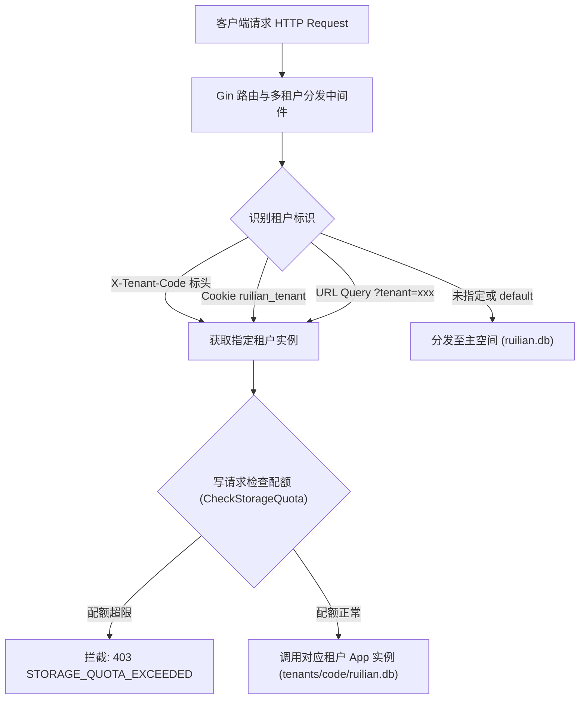
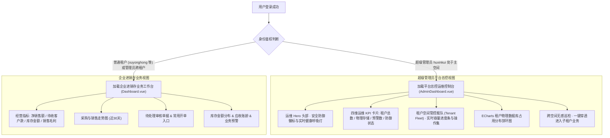

# 睿链进销存与往来管理系统 - 系统架构与多租户安全设计说明书 (V1.2)

> **版本**：V1.2  
> **更新时间**：2026-10-15  
> **文档定位**：记录 Database-per-Tenant 物理数据库独立架构、超级管理员专属账号加固（admin -> huxinkui）、防暴力破解安全防御体系、租户权限强隔离边界，以及全新超级管理员平台总控运维中心（Admin Dashboard）的设计与实现标准。

---

## 一、架构演进背景与改造驱动

随着睿链进销存与往来管理系统从“单机单企业”向“集团化多企业管控 / SaaS 平台”演进，系统需支撑多组织与多分支机构的独立核算与业务自闭环。同时，在公网或局域网多用户并发场景下，面临以下严峻挑战：

1. **公网暴露面与定向撞库攻击**：通用默认用户名（如 `admin`、`administrator`、`root`）常年遭受互联网自动化扫描工具、爬虫及字典爆破攻击。若保留默认 `admin` 账号，将成为系统最脆弱的安全短板。
2. **多租户数据强隔离要求**：传统的“逻辑隔离”（单一数据库内依靠数据表的 `tenant_id` 过滤）在开发复杂度高时极易因手写 SQL 遗漏字段而导致灾难性的跨租户数据越权与商业机密外泄。
3. **租户控制权边界与体验割裂**：普通租户（如分支机构、分公司或加盟商）仅应专注于企业采购、库存、销售及往来账务，严禁感知平台其它租户的存在，更不能接触多租户管理中枢；而平台超级管理员则需要全局俯瞰、动态配额调配、租户生命周期管控与跨空间无感穿透巡检。

---

## 二、Database-per-Tenant 物理数据库独立架构

### 2.1 物理沙箱存储布局

系统彻底摒弃逻辑分库，采用**物理数据库文件级完全隔离**架构：

```
data/
├── ruilian.db                 # [主平台管理库] 仅超级管理员 huxinkui 与主应用空间使用
├── ruilian.db-wal             # 主管理库预写日志 (WAL 模式)
├── ruilian.db-shm             # 主管理库共享内存
├── backups/                   # 全局与租户备份归档目录
├── logs/                      # 系统运行日志与审计日志
└── tenants/                   # [租户独立沙箱根目录]
    ├── xuyonghong/            # 租户专属目录（以租户唯一代码命名）
    │   ├── ruilian.db         # 该租户独立物理数据库
    │   ├── ruilian.db-wal     # 租户独立 WAL 日志
    │   └── ruilian.db-shm     # 租户独立共享内存
    ├── corp_bj/
    │   └── ruilian.db
    └── corp_sh/
        └── ruilian.db
```

### 2.2 核心特性与优势

1. **绝对物理隔离**：各租户的 SQLite 连接池、事务锁（`BEGIN IMMEDIATE`）、WAL 日志、Schema 与数据文件完全隔离。即便发生极端业务错误，也不会跨租户穿透。
2. **免冲突与高并发读写**：SQLite 在单文件写锁下具有局部排他性，采用多数据库后，各租户写操作在各自的物理文件上独立进行，天然实现租户间的写性能并行与互不干扰。
3. **极简备份与迁移**：每个租户的所有业务数据均封装在单一独立的物理文件或目录中，支持单租户物理打包、独立迁移、租户级销毁与按需配额扩缩容。

### 2.3 动态请求路由调度引擎

后端通过 `TenantManager` 维护租户 `App` 实例的动态缓存池：



### 2.4 物理存储配额与写操作拦截引擎 (Storage Quota Engine)

- **配额定义**：租户表字段 `max_storage_mb`（支持 200MB、500MB、1GB、2GB、自定义或 0 不限容量）。
- **物理穿透统计**：递归统计租户物理沙箱目录下所有文件（主数据库、WAL 文件、共享内存文件及关联日志）的真实字节总和。
- **毫秒级写拦截**：在所有非幂等写操作（`POST`、`PUT`、`DELETE`、`PATCH`）到达业务层前执行配额检查。一旦超限立即阻断并返回 `403`，只保留读取权限，确保单租户故障或恶意写入绝不击穿服务器物理硬盘。

---

## 三、核心安全防线与超级管理员专属化 (`huxinkui`)

### 3.1 废弃默认 admin 账号，消除定向攻击面

| 维度 | 旧版 (V1.0/V1.1) | 新版演进 (V1.2) |
| --- | --- | --- |
| **平台超级管理员用户名** | `admin` | **`huxinkui`** |
| **默认 admin 账号状态** | 可用、弱口令风险高 | **全面注销废弃并主动阻断**，登录直接报错 |
| **防暴力破解防护** | 仅依赖基础密码哈希 | **IPLoginLimiter** 连续失败 8 次封禁 15 分钟 |
| **防自动化脚本攻击** | 无验证码 | **CaptchaStore** 字符扰动干扰线图形安全验证码 |
| **租户空间账号规范** | 曾残留 admin 账号 | **租户库强力清理，严禁 admin/huxinkui 存在**，仅用专属租户 ID |

### 3.2 平滑无感自动化数据迁移

为保障已有系统在升级过程中不影响正在运行的业务数据，系统启动时内嵌自动化平滑升级迁移逻辑：
- 在 `EnsureDefaultAccount()` 与 `ensureTenantsTable()` 中：
  ```sql
  -- 自动将现有主数据库中的 admin 用户无损升级为 huxinkui
  UPDATE users SET username='huxinkui', name='超级管理员', updated_at=? WHERE username='admin';
  -- 升级默认主租户空间的 admin_user 为 huxinkui
  UPDATE tenants SET admin_user='huxinkui', name='平台总控管理中心' WHERE code='default';
  -- 清理租户子库中可能残留的 admin 与 huxinkui 记录
  DELETE FROM users WHERE username IN ('admin', 'huxinkui');
  ```
- 密码哈希、历史登录态、角色权限（`*`）全部无损保留，管理员直接以 `huxinkui` 凭现有凭据登录。

### 3.3 全方位防爆破拦截器与验证码体系

- **IP 登录频次限流 (`IPLoginLimiter`)**：
  - 单 IP 登录连续失败达到 8 次，自动触发 15 分钟临时封禁状态，并写入操作安全审计日志。
  - 封禁期间任何请求均直接返回阻断提示，保护后端哈希计算资源免遭 CPU 耗尽攻击（ReDoS / Hash Dos）。
- **内存化图形验证码 (`CaptchaStore`)**：
  - 登录接口强制校验图形验证码，采用字符随机倾斜、噪点干扰线、防混淆字符集（排除 `0/O/1/I/l`）。
  - 内存化单次消费与过期自动垃圾回收，彻底阻断撞库与自动化脚本工具。

---

## 四、租户权限强隔离与中枢界面屏蔽

### 4.1 普通租户界面完全屏蔽

- **侧边栏导航动态渲染**：
  - 普通租户（如 `xuyonghong` 等）登录后，系统通过 `App.vue` 中的计算属性严格过滤导航菜单。
  - **普通租户导航体系**：`经营工作台`、`基础资料`、`采购管理`、`销售管理`、`库存管理`、`往来管理`、`价格管理`、`报表中心`、`预警中心`、`系统管理`（仅管理自身员工、单据与自身备份）。
  - **「多租户管理」菜单项对普通租户 100% 隐藏**；顶部多租户切换选择器亦完全不向租户渲染。

### 4.2 前端路由全局强守卫 (Navigation Guard)

```ts
// router.ts 路由级守卫拦截
router.beforeEach((to, _from, next) => {
  if (to.path === '/tenants') {
    const app = useApp()
    if (app.user) {
      const isMaster = (app.user.username === 'huxinkui' || app.user.is_master_admin) &&
                       (app.tenant?.code === 'default' || !app.tenant?.code)
      if (!isMaster) {
        ElMessage.warning('无权访问：租户空间无权查看多租户管理页面')
        return next('/')
      }
    }
  }
  next()
})
```
即使恶意用户在浏览器上手动修改 URL 哈希路由为 `/#/tenants`，守卫立即识别非超级管理员身份，触发告警并强制重定向回工作台首页。

### 4.3 后端 API 强鉴权中间件 (`requireMasterAdmin`)

在 [server.go](file:///root/git/ruilian/internal/app/server.go) 中对所有多租户接口全量挂载专属鉴权中间件：

```go
func (a *App) requireMasterAdmin() gin.HandlerFunc {
    return func(c *gin.Context) {
        u := currentUser(c)
        if (!u.IsMasterAdmin && u.Username != "huxinkui") || (a.TenantCode != "" && a.TenantCode != "default") {
            a.error(c, denied("无权访问：租户无权访问租户管理"))
            c.Abort()
            return
        }
        c.Next()
    }
}
```

接口防护列表：
- `GET  /api/system/tenants`：租户列表与全局存储统计
- `POST /api/system/tenants`：创建独立租户物理数据库
- `PUT  /api/system/tenants/:code/storage`：调整租户存储配额
- `PUT  /api/system/tenants/:code`：修改租户基本信息
- `POST /api/system/tenants/:code/status`：启停租户空间状态
- `POST /api/system/tenants/:code/reset-password`：重置租户管理员专属密码

租户试图绕过前端直连调用上述接口，后端一律直接返回 `401 Unauthorized` 或 `403 Forbidden`。

---

## 五、超级管理员专属平台控制台 (Admin Dashboard)

超级管理员与普通租户进入完全不同的首页呈现，实现“管理视界”与“业务视界”的清晰分离：

### 5.1 界面分层架构



### 5.2 平台总控控制台核心板块

1. **暗夜蓝尊享 Hero 运维中枢**：
   - 突出超级管理员专属身份标识 `huxinkui`；
   - 实时绿色脉冲呼吸灯指示服务在线健康态；
   - 提供「新建租户空间」、「多租户中心」与「刷新状态」一键操作。
2. **核心安全加固横幅**：
   - 明示“`admin 账号已停用阻断`”、“`物理数据库隔离`”与“`IP 登录防暴力破解已生效`”，提升管理安全信心。
3. **四维运营指标网格**：
   - **租户空间总数**：运行中数量、已停用数量；
   - **物理存储总容量**：总配额、实际占用 MB、总使用百分比；
   - **容量预警租户**：统计使用率 ≥80% 的紧张租户，标明“需扩容”警示；
   - **平台防御机制**：标明超级管理员专属账号 `huxinkui` 在线，WAL 引擎运行。
4. **租户空间管控舰队 (Tenant Fleet)**：
   - 搜索与筛选：支持根据租户代码、名称或备注搜索，按正常/停用状态筛选；
   - 数据库路径透视：清晰标注租户物理存储路径（如 `data/tenants/xuyonghong/ruilian.db`）；
   - 配额使用进度条：动态着色展示已用/配额（≥80% 橙色预警，≥95% 红色危险）；
   - 操作集合：
     - **跨空间巡检**：一键无感切换至该租户空间查看进销存业务；
     - **调整配额**：弹窗快捷修改租户存储上限（MB），支持预设快捷按钮；
     - **重置密码**：一键重置租户专属管理员密码；
     - **启停切换**：一键冻结违规或到期租户，禁止登录。
5. **ECharts 数据可视化看板**：
   - 各租户物理存储占用分布图，清晰展示空间资源消耗占比。
6. **跨空间无感巡检模式联动**：
   - 超级管理员在管理后台点击「跨空间巡检」后，自动进入该租户的业务进销存工作台；
   - 顶部呈现专属红底横幅：“`跨租户监管中: <租户名> [代码]`”并附带“`返回平台控制台`”按钮，实现平台中枢与子租户业务的顺畅穿透与回跳。

---

## 六、核心实现源码索引

| 模块 | 源码文件 | 说明 |
| --- | --- | --- |
| **多租户引擎** | [internal/app/tenant.go](file:///root/git/ruilian/internal/app/tenant.go) | 租户数据模型、物理存储计算、配额检查、TenantManager 实例池 |
| **身份与安全** | [internal/app/auth.go](file:///root/git/ruilian/internal/app/auth.go) | 默认管理员升级为 huxinkui、租户空间 admin/huxinkui 清退、Authenticate 校验 |
| **API 与网关** | [internal/app/server.go](file:///root/git/ruilian/internal/app/server.go) | 多租户动态路由中间件、`requireMasterAdmin` 鉴权、登录防 admin 拦截 |
| **安全防御** | [internal/app/ip_throttle.go](file:///root/git/ruilian/internal/app/ip_throttle.go) | IP 登录失败频次限流器 (连续 8 次失败封禁 15 分钟) |
| **验证码服务** | [internal/app/captcha.go](file:///root/git/ruilian/internal/app/captcha.go) | 内存化图形验证码、字符扰动、干扰线与自动过期垃圾回收 |
| **自动化测试** | [internal/app/e2e_verify_test.go](file:///root/git/ruilian/internal/app/e2e_verify_test.go) | 端到端安全与多租户隔离自动化验证套件 |
| **平台控制台** | [frontend/src/pages/AdminDashboard.vue](file:///root/git/ruilian/frontend/src/pages/AdminDashboard.vue) | **超级管理员全新专属设计的平台总控运维控制台** |
| **业务工作台** | [frontend/src/pages/Dashboard.vue](file:///root/git/ruilian/frontend/src/pages/Dashboard.vue) | 动态分流：管理员加载 AdminDashboard，租户加载经营看板 |
| **多租户中心** | [frontend/src/pages/Tenants.vue](file:///root/git/ruilian/frontend/src/pages/Tenants.vue) | 完整多租户管理与配额管理中心（仅超级管理员可达） |
| **全局导航** | [frontend/src/App.vue](file:///root/git/ruilian/frontend/src/App.vue) | 差异化侧边栏与顶部栏渲染，普通租户完全隐藏租户管理 |
| **路由守卫** | [frontend/src/router.ts](file:///root/git/ruilian/frontend/src/router.ts) | 针对 `/tenants` 路由的强守卫拦截与告警跳转 |
| **全局状态** | [frontend/src/store.ts](file:///root/git/ruilian/frontend/src/store.ts) | 超级管理员计算属性、租户列表拉取安全控制 |

---

## 七、架构结论与后续重构建议

本次 V1.2 架构修改确立了：
1. **统一管理权归集于 `huxinkui`**，关闭了互联网上最常见的 `admin` 探测攻击窗口；
2. **底层采用 Database-per-Tenant 物理数据库隔离**，为后续支持大规模多组织协作打下了强有力的物理安全基础；
3. **前端与后端实施双重权限边界拦截**，租户无法越权感知或操作平台总控功能；
4. **管理控制台从单一业务看板升级为专职的 SaaS 平台总控运维中心**。

在您后续重新修改或扩展架构时，可重点参考：
- **租户数据自动冷热归档**：针对长期未活动的子租户数据库物理文件进行压缩或归档；
- **租户独立密钥体系**：结合 SQLite SQLCipher 对各租户物理数据库实施独立的透明硬件或密码级加密；
- **平台 OpenAPI 开放平台**：基于租户专属 AppKey / AppSecret 规范开放第三方系统对接。
